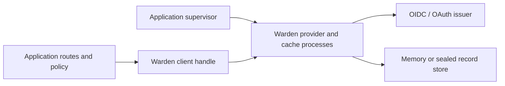

# Warden

OIDC login, OAuth 2.0 tokens and JWT access-token validation for Gleam on
Erlang/OTP. Warden manages provider discovery, signing keys and token custody;
your application owns its accounts, session cookies and permission checks.

This checkout is unreleased and pre-production. Production use requires the
[release conditions](docs/design/design-layer.pdf) and independent security review of
Warden-owned code. Warden is not certified.

## Capabilities

- OIDC authorization-code login with S256 PKCE and query or form-post callbacks.
- Checked identity and application-decoded claims, keyed by issuer and subject.
- Opaque user sessions, near-expiry refresh and shared concurrent refreshes.
- Logout with separate local-custody, revocation and provider-redirect outcomes.
- Confidential service clients for client credentials, userinfo and introspection.
- Local RFC 9068 JWT access-token validation with audience and scope policy.
- Supervised discovery and signing-key caches with restart-stable client handles.
- Optional sealed durable custody through a conditional-record store, including
  the separate [PostgreSQL adapter](integrations/warden_postgres/README.md).

## When to use Warden

Use it to sign users into a Gleam web application through an existing identity
provider, obtain OAuth tokens for a service, or protect an API with JWT access
tokens. It does not supply an authorization server or your application's browser
session and authorization policy.

## Installation

Requires Gleam 1.18 or later and the Erlang target. Add Warden to your application's
`gleam.toml`; Gleam fetches its Git dependencies without sibling checkouts:

```toml
[dependencies]
warden = { git = "https://github.com/gleam-dream/warden.git", ref = "main" }
```

Commit `manifest.toml` to retain the resolved revisions. The
[reference application](consumer/) includes the HTTP dependencies and route
integration used below.

## Sign a user in, then call an API

Register the callback address with your issuer and load the client secret from
trusted configuration. This excerpt defines startup, login/callback handlers,
API authorization and logout:

<!-- prettier-ignore-start -->

<!-- snips: consumer/src/warden_reference/usage/login.gleam#login -->
```gleam
import gleam/http/request.{type Request}
import gleam/http/response.{type Response}
import gleam/result
import warden
import warden/config

pub fn start(secret: String) -> Result(warden.Client, warden.StartError) {
  let config =
    config.new(
      issuer: "https://login.example.com",
      client_id: "app",
      redirect_uri: "https://app.example.com/auth/callback",
      authentication: config.ClientSecretBasic(config.secret(secret)),
    )
    |> config.with_scopes(["email", "profile"])
  // Validates; starts nothing.
  use client <- result.try(warden.new(config))
  // Discovery, keys, processes.
  use Nil <- result.map(warden.start(client))
  client
}

/// GET /login: Warden sets the browser-binding cookie and the redirect.
pub fn login(client: warden.Client, req: Request(a)) -> Response(String) {
  case warden.begin_login(client, req, warden.default_login()) {
    Ok(redirect) -> warden.login_response(response.new(303), redirect)
    Error(error) ->
      response.new(503) |> response.set_body(warden.describe_login_error(error))
  }
}

/// GET (or POST, for form-post) /auth/callback, with the body as a String.
pub fn callback(
  client: warden.Client,
  req: Request(String),
) -> Result(String, warden.Action) {
  case warden.complete_login(client, req) {
    // Keep the reference in the application's session.
    Ok(session) -> Ok(warden.session_reference(session))
    // Reauthenticate, RejectRequest, Recover, ...
    Error(error) -> Error(warden.login_error_action(error))
  }
}

/// Any later request: a current token, refreshed within 30 s of expiry;
/// concurrent requests share one refresh.
pub fn call_api(
  client: warden.Client,
  reference: String,
  api_request: Request(a),
) -> Result(Request(a), warden.SessionError) {
  use session <- result.try(warden.restore_session(client, reference))
  use access <- result.map(warden.access_token(client, session))
  warden.authorize(api_request, access.token)
}

/// POST /logout: custody removed, refresh token revoked (RFC 7009).
pub fn logout(
  client: warden.Client,
  session: warden.Session,
) -> Response(String) {
  case warden.logout(client, session, warden.default_logout()) {
    Ok(warden.LoggedOut(
      provider_logout: warden.RedirectToProvider(redirect),
      ..,
    )) -> warden.logout_response(response.new(303), redirect)
    _ -> response.new(303) |> response.set_header("location", "/")
  }
}
```

<!-- prettier-ignore-end -->

The [complete module](consumer/src/warden_reference/usage/login.gleam) compiles in
the reference consumer. Its [common-path test](consumer/test/warden_reference_test.gleam)
exercises the equivalent login, token and logout flow against a local test provider.
The application stores the session reference in its protected browser session.

## How it works



`Config` describes the client role. `warden.new` allocates stable names;
`warden.start` starts a manually owned client, while `warden.supervised` installs
it under your supervisor. Background discovery can return `ProviderNotReady`
until metadata and keys arrive. A `Session` is an opaque custody reference, not
an application session or permission grant.

Use the [supervision example](consumer/src/warden_reference/usage/supervision.gleam)
for a long-lived service. Stop supervised clients through their parent; manually
started clients need `warden.stop` after the application stops admitting work.

## Resource servers

Use the separate resource-server role to check JWT access tokens against cached
issuer keys. This example maps verification outcomes to HTTP status codes:

<!-- prettier-ignore-start -->

<!-- snips: consumer/src/warden_reference/usage/resource_server.gleam#resource-server -->
```gleam
pub fn start(
  issuer: String,
) -> Result(#(warden.Client, resource.Validator), warden.StartError) {
  let assert Ok(client) = warden.new(config.resource_server(issuer:))
  use Nil <- result.map(warden.start(client))
  #(client, resource.new(client, audience: "https://api.example.com"))
}

/// The HTTP status a failed token earns: 401, 403 or 503. A token issued for
/// another resource is answered as a rejected one here.
pub fn status(validator: resource.Validator, bearer: String) -> Int {
  case resource.verify(validator, bearer) {
    Ok(_claims) -> 200
    Error(error) ->
      case resource.error_kind(error) {
        resource.Rejected | resource.WrongAudience -> 401
        resource.Forbidden -> 403
        resource.Unavailable -> 503
      }
  }
}

```

<!-- prettier-ignore-end -->

[Local validation](src/warden/resource.gleam) does not observe immediate token
revocation. A suitably authenticated service client can instead use
`warden.introspect` to ask the provider for current token state. Resource-server
configuration alone supplies no introspection credentials.

## Operational notes

- Use `(issuer, subject)` as identity, not email. Protect application session
  cookies and apply CSRF/origin and permission checks at your routes.
- Memory storage loses sessions on restart. Durable custody needs a protected
  32-byte sealing key, conditional writes and rollback protection; the application
  owns migrations, pool lifetime, capacity and backup policy.
- Do not blindly resend a possibly consumed authorization code or refresh token.
  Branch on `login_error_action` or `session_error_action`; keep errors carrying
  `Recover` evidence for `recover_custody` or `recover_refresh`.
- Provider traffic uses verified HTTPS and public destinations by default.
  Login checks issuer, audience, nonce and callback matching. Register every
  allowed callback address with the provider.
- `warden.stop` and the login deadline do not prove that every worker or external
  effect has finished. Keep borrowed resources alive for the required completion boundary.

## Examples and reference

- [Usage modules](consumer/src/warden_reference/usage/): supervision, durable stores,
  callback addresses, resource servers and a local HTTPS test provider.
- [Relay integration](relay_consumer/src/recipe.gleam): JWT and introspection verifiers.
- [PostgreSQL storage](integrations/warden_postgres/README.md): optional adapter;
  the core does not depend on it.
- [Design](docs/design/design-layer.pdf): protocol scope, defaults and unresolved requirements.
- [Oracle](docs/ORACLE.md) and [measurements](docs/BENCHMARKS.md): retained evidence
  with its revisions and limits, not a release certification or current performance promise.
- [Development commands](AGENTS.md): local checks, provider suites and browser tests.
